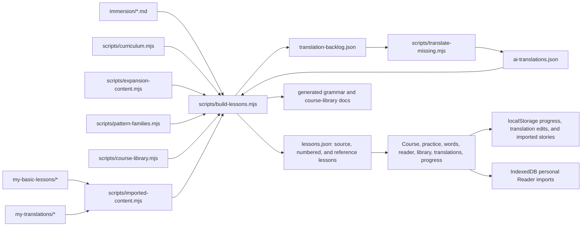
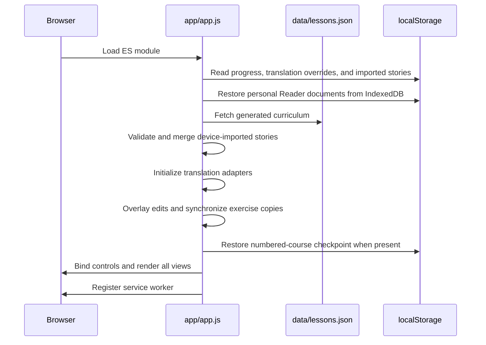
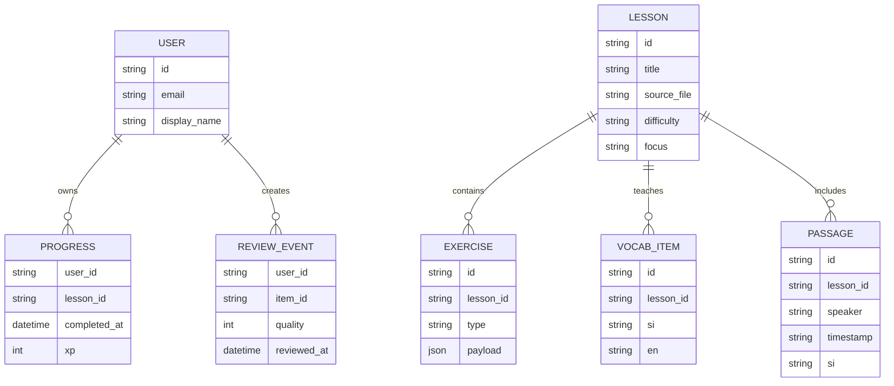

# App Architecture

This project is a static, phone-friendly web app built around the existing `Immersion/` folder. It has no required server backend. Progress is stored in the browser with `localStorage`; personal Reader imports use browser IndexedDB so longer transcripts remain device-local without competing with progress storage.

For implementation-oriented navigation, use [Codebase Map](codebase-map.md). For coding conventions, migrations, and validation, use [Development Guide](development-guide.md). [Language Sources](language-sources.md) records the external research basis. Repository-wide agent requirements live in [AGENTS.md](../AGENTS.md).

## Goals

- Use downloaded Sinhala scripts as the source of truth.
- Generate structured lessons from messy Markdown notes.
- Provide a searchable direct-study library from basic topics through advanced grammar.
- Keep the app usable on a phone.
- Allow offline study after first load through a service worker.
- Keep the architecture simple enough to rebuild later with a real backend.

## File Map

| Path | Purpose |
| --- | --- |
| `Immersion/` | Source scripts, transcripts, vocabulary notes |
| `my-basic-lessons/` | Imported lesson notes and verb JSON data that can become extra topic lessons, verb guides, and word-drill material; `app-curated` comment blocks restrict learner-facing parsing to reviewed content when needed |
| `my-translations/` | AI-authored or imported phrase and word translations queued for review |
| `scripts/curriculum.mjs` | Hand-authored graded grammar structures and conversation scenarios |
| `scripts/expansion-content.mjs` | AI-marked grammar variants, dialogue variants, and topical vocabulary packs |
| `scripts/pattern-families.mjs` | Larger authored pattern-family corpora for rotating the same concept through different lexical choices |
| `scripts/course-library.mjs` | Researched grammar additions, staged topic lessons, and source catalog |
| `scripts/imported-content.mjs` | Parses imported lesson notes, verb JSON, and translation files into extra lesson and vocabulary sources |
| `scripts/import-story.mjs` | Normalizes nested timestamp/speaker story notes into tagged and deduplicated immersion Markdown |
| `scripts/build-lessons.mjs` | Scans Markdown and generates lesson data |
| `scripts/translate-missing.mjs` | Translates pending passages with Google Translate and resume support |
| `data/lessons.json` | Generated course data consumed by the app |
| `data/ai-translations.json` | Stable-keyed machine translations imported as `AI*` |
| `data/translation-backlog.json` | Generated list of lines that need reviewed full translations |
| `scripts/serve.mjs` | Local network server for phone testing |
| `scripts/build-deploy.mjs` | Public bundle builder and complete cache-coverage validator |
| `app/index.html` | App shell |
| `app/styles.css` | Mobile-first visual system |
| `app/app.js` | Rendering, quiz flow, progress, script search |
| `app/story-import.js` | Browser-side parser and validator for prepared story Markdown |
| `app/reader-import.js` | Browser-side normalizer for personal transcriber JSON and translated Markdown reader files |
| `app/sw.js` | Service worker cache |
| `app/precache-assets.json` | Required offline app, data, and documentation asset list |
| `app/manifest.webmanifest` | Installable web app metadata |
| `docs/lesson-plans.md` | Human study plan |
| `docs/language-sources.md` | Research sources, their roles, and usage caveats |
| `docs/course-library.md` | Generated bilingual topic-course reference |
| `docs/grammar-and-conversations.md` | Generated bilingual curriculum reference |
| `docs/architecture.md` | Technical plan |
| `docs/codebase-map.md` | Agent-oriented ownership, function, schema, and change map |
| `docs/development-guide.md` | Engineering best practices and validation checklist |
| `AGENTS.md` | Mandatory instructions for coding agents |

## Data Pipeline



The generator looks for:

- Tagged story frontmatter for an explicit title, difficulty, course level, topics, lesson tags, and grammar tags.
- Sinhala text using the Unicode Sinhala block.
- Vocabulary bullets in the form `- word = meaning`; repeated entries merge all distinct pipe-separated meanings.
- Speaker labels like `- Mother`.
- Bold speaker labels like `**Mother**`.
- Timestamps like `1:45` or `## 0:00 - 2:02`.
- Passage children such as `@tags = past-events | genitive`, followed by the full English translation as the final indented bullet.
- Consolidated glossary children such as `@tags = kind:phrase | difficulty:story | topic:reasons-and-conditions | grammar:conditional-nam | lesson:reference-reasons-plans`.
- Recurring grammar signals such as negation, past tense, needs/wants, connectors, and verb chains.
- Full English line translations already written under Sinhala lines.
- Stable translation keys based on the source file and exact Sinhala text.
- Imported verb data from `my-basic-lessons/SinhalaVerbRules_Expanded.json` and `my-basic-lessons/SinhalaVerbsData_100.json`.
- AI translations from `data/ai-translations.json`.
- Draft glosses only when a new line has not been translated yet.

## Runtime Lifecycle

The browser has no framework or router. `app/app.js` loads one generated JSON payload, imports dependency-free Story and Reader parsers, restores saved story Markdown plus personal Reader documents, and renders eight view containers from shared module state.



Dynamic subtree events are bound after each render. The app replaces container HTML instead of reconciling components, so every new renderer must both escape content and reinstall the events for the nodes it creates.

Grammar and conversation concepts can own many authored variants. The scheduler reviews the concept while the runtime rotates among those variants to avoid drilling one frozen sentence.

## Identity Contracts

Several generated identifiers are also persistence contracts:

- Source lesson IDs connect stories to story-practice history and are derived from filenames.
- Course lesson IDs connect numbered lessons to completion history and are derived from generated sequence order.
- Passage and source-vocabulary translation keys hash the source path plus normalized Sinhala text.
- Curriculum translation keys derive from stable grammar, conversation, vocabulary-pack, reference-topic, and variant IDs.
- `reviewKey` identifies a card; `skillId` groups equivalent cards into one spaced-repetition concept; `variantId` records the phrase most recently shown.

For grammar and conversation concepts, variant index order is also part of the durable translation-key scheme, so new variants should be appended rather than inserted ahead of existing ones.

Changing these values can orphan local progress, local approvals, or stored Google translations. Treat source renames, sequence renumbering, and curriculum-ID changes as migrations. See [Development Guide](development-guide.md#stable-identifier-practices).

## Lesson Data Model

The generated JSON keeps source material and course sequencing separate.

A source lesson represents one immersion script:

```json
{
  "id": "red-shoes",
  "title": "Red Shoes",
  "source": "Immersion/Red Shoes Script.md",
  "difficulty": "intermediate",
  "focus": "past events through story scenes",
  "topics": ["betrayal", "forgiveness"],
  "tags": ["story", "dialogue"],
  "grammarTags": ["past-events", "reported-content"],
  "vocabulary": [],
  "passages": [],
  "grammar": [],
  "grammarLessons": [],
  "exercises": [],
  "storyExercises": []
}
```

A course lesson is a short mixed practice session assembled from several source lessons:

```json
{
  "id": "course-lesson-001",
  "number": 1,
  "title": "Lesson 1",
  "unit": 1,
  "level": "basic",
  "focus": "Core words and simple sentence order",
  "sourceLessonIds": ["red-shoes", "the-ant-and-the-dove"],
  "referenceLessonIds": ["reference-script-sounds"],
  "referenceTopicTitle": "Script and sound contrasts",
  "referenceTopicGoal": "Recognize a first set of letters and sound contrasts.",
  "grammarLessons": [],
  "subLessons": [
    { "id": "course-lesson-001-warmup", "title": "Warm-up", "kind": "warmup", "exercises": [] },
    { "id": "course-lesson-001-grammar", "title": "Grammar", "kind": "grammar", "exercises": [] },
    { "id": "course-lesson-001-conversation", "title": "Conversation", "kind": "conversation", "exercises": [] },
    { "id": "course-lesson-001-immersion", "title": "Immersion", "kind": "immersion", "exercises": [] }
  ],
  "roundQuestionTarget": 10,
  "variationPool": [],
  "exercises": []
}
```

`exercises` is the flattened form of `subLessons` for compatibility and indexing. Source lessons own passages, vocabulary, translation provenance, story metadata, a compact `exercises` set used by the numbered course, and an expanded `storyExercises` bank used only by story practice. Each course grammar structure carries a generated `difficultyRank` from 1 to 103. Each source passage carries ranked `grammarMatches` for the full displayed block plus generated `sentences` fragments with compact `grammarMatchIds`; the app resolves those IDs through `course.scriptGrammarRules` and derives sentence structure at render time for sentence-level grouping. Course lessons reference those sources plus one course-library topic and own the ordered practice experience. Numbered lessons choose sentence-builder cards from both eligible source lines and the assigned topic, using the least-used sentence concept first so short source pools do not repeat one prompt across the path; each lesson still includes a source-script exercise. A larger `variationPool` holds at least 20 candidate cards per numbered lesson, rising by level. Cards carry `topicAligned` and `courseRole` metadata so the runtime can prefer the named topic while deliberately retaining one grammar extension, one conversation extension, and one real-script immersion card in the pool.

A reference lesson is a compact, direct-study topic. Its learner-facing vocabulary, phrases, dialogue turns, and linked grammar structures may include grammar-role `tags`, which Library displays as compact labels. These tags distinguish roles such as `normal-subject`, `dative-experiencer`, `recipient-ta`, `destination-ta`, and `direct-object-va`; they are descriptive metadata and do not change spaced-repetition identity.

A reference lesson has this shape:

```json
{
  "id": "reference-greetings-courtesy",
  "number": 2,
  "title": "Greetings and courtesy",
  "level": "basic",
  "goal": "Greet someone and use everyday polite expressions.",
  "grammarIds": ["basic-zero-copula-adjective", "basic-polar-question"],
  "vocabulary": [],
  "phrases": [],
  "conversation": [],
  "studyGuide": null,
  "subLessons": [
    { "title": "Words", "exercises": [] },
    { "title": "Patterns", "exercises": [] },
    { "title": "Conversation", "exercises": [] }
  ],
  "exercises": [],
  "reviewExercises": []
}
```

Reference lessons appear under `course.referenceLessons`. Their variants feed numbered lessons and SRS, and they remain searchable and independently practiceable in Library. Imported verb lessons may also carry a `studyGuide` object with morphology rules, curated Sinhala-script verb forms, preserved romanized alternatives, form labels, three source usage examples for each form with complete English sentence translations, and a `progressiveGuide` that contrasts an ordinary `-නවා` present/nonpast sentence with an explicitly ongoing `-මින් ඉන්නවා` sentence. The generator corrects the subject to the dative `-ට` form for examples using want, like, or ability helpers, while retaining the untouched source romanization as provenance; the Library renders this as a dedicated verb-study section without turning the reference forms into unreviewed translation rows. A verb example begins in Sinhala script or the configured runtime transliteration and reveals its complete English translation when tapped. The existing transliteration-rate setting controls whether those verb guide forms and examples display as Sinhala script or romanization. Completing a focused topic review does not mark a numbered lesson complete or reorder the course. The source catalog used by Library and the generated documentation is under `course.sources`.

Each passage records translation provenance:

```json
{
  "translationKey": "t-1ca06e1f0680e7e2",
  "en": "She went home.",
  "translationStatus": "ai-translated",
  "translationOrigin": "Google Translate",
  "aiMarked": true
}
```

A passage from a structured story import can also carry descriptive `tags`. The Stories search and reader expose those tags, and passage-derived practice cards retain them. Tags never participate in stable identity.

A structured source vocabulary item can additionally carry `kind`, `level`, `topics`, `grammarTags`, `referenceLessonIds`, and its complete `tags` list. The story importer classifies words and multiword phrases separately, assigns their own difficulty rather than inheriting the whole story's level, and maps semantic or grammatical signals to existing Library lesson IDs. Course warm-up selection treats a matching tagged source item as topic-aligned; Words places it in the corresponding level drill. These routing tags remain descriptive metadata and do not alter translation or SRS identities.

The same normalized Markdown has two delivery paths. Build imports remain repository-owned: the file lives in `Immersion/` and `build-lessons.mjs` emits it into generated data. Browser imports are learner-owned: Stories validates the selected `.md`, stores its source text under `sinhala-imported-stories`, and rebuilds a device-local lesson at startup. Runtime integration adds the full narrative only to Stories/story practice, adds vocabulary to the mixed and matching-difficulty Words sets, and adds vocabulary warm-ups only to Course lessons whose reference topic matches a `lesson:` tag and whose level is not below the item's difficulty. It does not change generated JSON or repository files.

Reader imports are a separate personal path. Reader accepts a transcriber `transcript.json` (`speakers` and translated `segments`) or the generated translated Markdown layout with bold speaker headings, Sinhala bullets, nested `Sinhala = meaning` rows, and a final English child line. The chosen import name is the case-insensitive replacement identity. The Reader library provides search and sort; choosing **Open** presents a full-screen Sinhala-first overlay, and **Back** closes it without navigating the app. That overlay has a device-local light/dark setting under `sinhala-settings`; its existing inline word card, phrase paging, editing, and full-line translation controls use the selected theme. The separate Manage panel owns import, backup, and an on-demand help dialog with accepted file-format examples. Reader uses a separate device-local canonical glossary, keyed by normalized Sinhala term, across every Reader document. Imports merge distinct English meanings case-insensitively without removing prior meanings; an explicit edit begins with the global values and replaces that term’s list after case-insensitive de-duplication. Previous/next arrows page through global multi-word entries containing the word which occur in the same segment, shortest first; disabled arrows visibly indicate no available phrase. **Export Reader backup** produces versioned JSON containing every Reader document and the canonical glossary; v1 document-only backups remain importable and their glossary is rebuilt. Restore validates all documents before writing, merges glossary meanings, replaces only matching saved names, and preserves Reader documents not in the backup. Personal Reader documents and the shared glossary use IndexedDB, with local-storage fallbacks when direct-file browser contexts expose IndexedDB as null; they never enter generated data, practice, translation review, or Course state.

`translationStatus` is `translated` for script notes, `ai-translated`, `reviewed` for a local user override, or `draft-gloss` for a newly imported line still awaiting translation.

Generated exercise types:

- `choice`: multiple-choice vocabulary recognition. The first selection is scored immediately and locks every word choice, leaving **Next** as the only forward action.
- `word_choice`: dedicated word-drill translation in either direction.
- `matching`: match Sinhala vocabulary to English.
- `fill_blank`: complete a real script line.
- `sentence_build`: translate in either direction by tapping word tiles into order.
- `structure`: identify sentence parts and final verbs.
- `response`: produce a short Sinhala response.
- `speaking`: say a real script line aloud and review structure.
- `grammar_choice`: recognize a target grammar pattern in bilingual examples. Tapping an option reveals its translation and gives the selected card a visible outline; **Submit** checks it, locks every option regardless of the result, and exposes the separate **Next** action.
- `conversation_choice`: choose a natural bilingual reply to a dialogue turn.
- `conversation_response`: produce a reply, then compare it with a model answer.

A sentence-builder card keeps the ordered answer separate from the shuffled runtime bank:

```json
{
  "type": "sentence_build",
  "direction": "en_to_si",
  "prompt": "Where are you going?",
  "answerTokens": ["ඔයා", "කොහෙද", "යන්නේ"],
  "distractorTokens": ["මම", "ගෙදර"],
  "wordBank": ["ඔයා", "කොහෙද", "යන්නේ", "මම", "ගෙදර"],
  "reviewKey": "sentence:<translationKey>:en_to_si",
  "skillId": "sentence:<translationKey>"
}
```

`sessionChoices` is the shuffled bank for one attempt, while the learner's selection stores bank indexes so repeated words remain distinct tiles. English translation edits regenerate the prompt or answer tokens and bank at runtime.

The payload also includes `course.wordPracticeSets`, which gather source vocabulary, imported-note vocabulary, imported verb forms, reference-topic words, and expansion packs into dedicated word-drill sessions.

## Course Sequencing

The builder interleaves exercise pools from all source scripts and emits numbered lessons with a larger runtime pool. Every course lesson has four sub-lessons in a stable teaching order: Warm-up, Grammar, Conversation, and Immersion. It assigns one course-library topic in beginner-to-advanced order and guarantees at least one complete runtime round's worth of topic-aligned cards. Topic vocabulary is practiced in both directions; phrase-only and word-only imports use their available phrase, structure, builder, or open-response cards instead of unrelated empty-part fallbacks. Every lesson also retains a real script line, a grammar-coverage extension, a conversation extension, and sentence-building practice. Main-path token limits rise from 7 in Basic to 14 in Advanced, while the generator naturally selects even shorter beginner phrases when available. Grammar density varies so that all 103 structures are introduced.

Course rounds are sampled at runtime from each lesson's `variationPool`: Basic and Foundation target 10 questions, Story and Conversation target 11, and Advanced targets 12. Generated pools contain 20, 24, 28, 30, or 32 cards respectively. The sampler first places a real-script card in Immersion, then prefers topic-aligned cards in every part before drawing the small grammar, conversation, or due-review extensions. Each of the three required passes rebuilds the session from that pool, so the lesson is longer overall without forcing one static 30-card sitting.

The 108-lesson sequence is ordered Basic -> Foundation -> Story -> Conversation -> Advanced and divided into visual units of 10 lessons. The first unfinished numbered lesson is recommended. A numbered lesson is completed only after three full runtime passes, and each new pass rebuilds the session so the learner sees fresh permutations before the app advances. The sequence may grow when imported lesson-note, verb-guide, or structured story material raises the minimum lesson count needed to surface available content.

The sequence is open rather than locked. The Course path and Practice picker allow skipping ahead, going back, and reviewing completed lessons. Progression is recommended rather than enforced: the first unfinished lesson is the next step, but the learner can always choose another level or revisit completed material.

Reference-topic reviews, word drills, and story practice are side routes. Story practice now uses three varied rounds and records which source-owned cards have been seen, while reference and word sessions remain single focused reviews. Reference reviews select from the topic's larger review pool and prefer cards not shown earlier in the current browser session. A continued review temporarily shortens when fewer unseen cards remain, rather than repeat a card. Each side route records its own completion map. When it ends, the selected item remains active in Practice and the learner explicitly chooses Continue for a fresh session or Exit back to Words, Stories, or Library; side routes never auto-resume the numbered course.

Numbered-course practice keeps a device-local checkpoint for the active lesson, current round, exercise position, and selected session ordering. If the learner leaves Practice and comes back later, the app resumes that in-progress round instead of rebuilding the lesson from the start. The Course path also surfaces that checkpoint visually with a progress ring around the lesson number.

## Session Randomization and Spaced Repetition

`prepareSession()` creates a fresh runtime session whenever a lesson starts, restarts, or advances to another numbered-course pass. It preserves the pedagogical order of the four sub-lessons, shuffles exercises inside suitable parts, and shuffles answer choices. Focused Library reviews retain their Words, Patterns, and Conversation mix while sampling each new session from the topic's larger review pool, preferring cards not shown since the page was loaded; they temporarily shorten instead of repeating a card when fewer unseen cards remain. `materializeExerciseVariant()` then selects a phrase variant while avoiding the last variant recorded for that concept. Conversation recognition stays before conversation production and shares the same selected dialogue with the response card.

Every exercise has a stable card-level `reviewKey` and a concept-level `skillId`. `updateSpacedRepetition()` stores one review record per `skillId`:

- An incorrect answer resets the streak and schedules the item for about 10 minutes later.
- The first consecutive correct answer schedules it for 1 day later.
- The second schedules it for 3 days later.
- Later correct answers multiply the previous interval by an ease factor, capped at 90 days.
- Incorrect answers lower ease; correct answers slowly raise it.

At course-session creation, the engine selects due concepts at or below the chosen lesson's level, excludes concepts already taught in that lesson, and randomizes among the earliest due candidates. The review pool includes expansion-word cards, reference-topic variants, source-sentence cards, dedicated word-drill concepts, and a larger authored pattern-family bank for grammar and dialogue. Its sentence builders are evenly divided between both translation directions. The two directions for one sentence share a `skillId`, so later review can switch direction while preserving one concept schedule. Grammar and conversation exercises now expose deeper variant stacks so the learner sees the same structure with different nouns, verbs, times, and places. The selected card and phrase avoid the learner's last exposure when another option exists. The course engine inserts no more than one review in Basic and no more than two in later levels. Story sessions do not insert an external due-review block, but their own source-card sampler prefers due SRS concepts and cards not yet seen in that story. Reference, word, and story scored answers all update SRS records.

## Sentence Breakdown

Each passage includes a heuristic structure object:

```json
{
  "likelyOrder": "Subject / setting / object / verb",
  "parts": {
    "connector": [],
    "subject": [],
    "recipient": [],
    "possessive": [],
    "timePlace": [],
    "object": [],
    "verb": [],
    "negation": []
  },
  "finalVerb": ""
}
```

The current analyzer is rule-based. It is useful for study, but a later production version should allow manual corrections.

## App Views

### Course

The course shows numbered lessons in units, identifies the next unfinished lesson, and allows jumping ahead or reviewing older lessons. Story titles are deliberately absent from this path.

### Practice

The practice view is the continuous learning loop. It includes vocabulary, grammar, conversation, fill-in-the-blank, bidirectional sentence building, sentence structure, response, and speaking cards. Sentence builders present a prompt, an ordered answer area, shuffled word tiles with distractors, tap-to-remove correction, and explicit Check feedback. A compact label shows both the active sub-lesson and total progress. Completing a lesson awards XP, updates the streak, briefly confirms completion, and begins the next numbered lesson without returning to Course.

### Words

The Words view lists dedicated word-drill sets. These are grouped as one mixed set plus level-based sets, currently six total. Imported verb-form drills from the verb JSON files are included in the level sets. Each drill runs in `practiceMode === "words"`, tracks completion separately, uses the same translation-edit propagation as the rest of the app, and offers Continue or Exit when finished rather than switching into Course.

The same screen also exposes the transliteration-rate control. Sinhala script remains the stored display truth for generated practice, including imported verb JSON after romanization-to-script conversion, but Practice can swap eligible prompts, tiles, choices, and verb-guide examples into transliteration at runtime. The current default is 20%, and the user can turn it off completely.

### Stories

The story reader lets you search source scripts, open their full reader views, and optionally practice exercises grouped by one source. Story practice samples from `storyExercises`, which can include all source vocabulary, matching chunks, fill blanks, structure cards, speaking cards, responses, and bidirectional sentence builders from suitable short bilingual passages or phrase notes. Finishing three story rounds records it separately, then offers Continue for the same story or Exit back to Stories; unseen cards remain preferred until the available bank has been covered.

The Stories header includes a grammar-order toggle. Normal mode preserves the original source block order. Grouped mode splits each displayed block into generated sentence fragments, assigns each sentence to its most advanced detected grammar match, then renders the groups from lowest rank to highest rank so the same script can be read from easier structures toward harder ones.

The Stories screen also accepts prepared `.md` files up to 2 MB. Import is device-local and works without a backend: valid records persist across reloads and remain available offline while browser storage survives. Reimporting the same title and filename replaces its local version. **Forget imported story** removes its runtime lesson, word-bank entries, and Course variations from that browser without deleting the original file. The repository build import remains available independently.

Every reader line has:

- Sinhala text with clickable word lookup.
- A full translation from source notes or the AI translation pass.
- A visible `AI*` badge wherever a machine translation still needs review.
- Sentence-structure notes.
- A grammar rank label when the line has a detected match.
- A copy button.
- Lesson-level copy.

Sinhala tokens are clickable. Exact and inflected glossary matches appear in a popover; when a transcript token has no glossary entry yet, the full line translation remains directly beneath it for context.

### Library

Library is a level-filtered and searchable reference containing 43 topic lessons, including 23 built-in course topics, 15 imported note topics, and 5 imported verb-guide topics, along with 103 sentence structures and 30 conversation scenarios. Content filters isolate topic lessons, grammar, or conversations. Each expandable topic includes a goal, linked grammar, bilingual vocabulary, useful phrases or a verb study guide when available, a mini conversation when available, copy controls, and a focused review launch. Every Sinhala item has an English translation, clickable word lookup, and an `AI*` badge when applicable; verb-guide usage sentences reveal their English gloss directly when tapped. Grammar-role tags identify intentional dative, recipient, destination, and direct-object examples. The source list links to the external course and grammar materials used to check coverage.

### Translations

The translation workspace can search every Sinhala or English sentence or standalone word, including source glossary entries, expansion vocabulary, reference-topic content, grammar phrases, and every conversation choice. A type filter provides separate word and phrase queues, and the default queue shows AI-translated words that need review. The `AI*` marker is controlled independently from the text. Curriculum entries appear under virtual `Curriculum · Level` lessons; expansion words appear under `Vocabulary · Topic` lessons; direct-study entries appear under their course-topic title.

Browser edits are stored under `sinhala-translation-overrides` in `localStorage`. Each override contains English text, marker state, and edit time under a stable translation key. An approved edit is propagated into the reference library, word lookup, matching, practice choices, model replies, and the active session. Export/import moves this small JSON dataset between devices.

Generated translations in `data/ai-translations.json` are never changed by browser edits. Resetting an edit returns to that generated baseline.

### Progress

The progress view links to study documentation, shows corpus stats, and tracks local study behavior.

## Progress Storage

Progress is local to the device:

```json
{
  "streakDays": 1,
  "lastStudyDate": "2026-08-15",
  "lessons": {
    "course-lesson-001": {
      "completedAt": "2026-08-15T03:00:00.000Z",
      "xp": 28
    }
  },
  "wordPractices": {
    "words-basic": {
      "completedAt": "2026-08-15T03:15:00.000Z",
      "xp": 16
    }
  },
  "storyPractices": {
    "red-shoes": {
      "completedAt": "2026-08-15T03:30:00.000Z",
      "xp": 28,
      "timesPracticed": 1,
      "seenReviewKeys": ["sentence:t-1ca06e1f0680e7e2:en_to_si"],
      "totalReviewKeys": 72,
      "lastPracticedAt": "2026-08-15T03:28:00.000Z"
    }
  },
  "referencePractices": {
    "reference-greetings-courtesy": {
      "completedAt": "2026-08-15T03:45:00.000Z",
      "xp": 26
    }
  },
  "exerciseStats": {},
  "reviewItems": {
    "grammar:sov-order": {
      "type": "grammar_choice",
      "skillId": "sov-order",
      "dueAt": "2026-08-16T03:00:00.000Z",
      "intervalDays": 1,
      "ease": 2.3,
      "streak": 1,
      "attempts": 1,
      "correct": 1,
      "lapses": 0
    }
  },
  "attempts": 0,
  "correct": 0,
  "vocabClicks": 0,
  "copiedLines": 0,
  "readerOpens": 0
}
```

For a future multi-device app, replace this with an authenticated API and database.

Translation edits are also local to the device. Export them before clearing site data or moving to another phone.

The transliteration display setting is also local to the device and is stored separately under `sinhala-settings`.

## Translation Pipeline

Run the pipeline in this order:

```sh
npm run build:data
npm run translate:data
npm run build:data
```

The translation runner sends only pending Sinhala passages to Google Translate and saves every 25 results, so it can resume after interruption. Repeated source lines share one stable translation. The final build merges those results into lessons and exercises.

Machine translation is especially uncertain for noisy speech-to-text, names, slang, and broken sentence boundaries. Keep `AI*` until you have checked the line against its video.

## Future Backend

When you are ready to build the full version, add:

- User accounts.
- Lesson completion sync.
- Cross-device review scheduling and conflict resolution.
- Audio/video clip references.
- Manual lesson editing.
- Script import and cleanup tools.
- Speech recording and comparison.

A practical database shape:



## Future Lesson Engine

A more adaptive version should add:

- Listening prompts tied to video timestamps.
- Speaking prompts with recording.
- Skill-level mastery estimates across vocabulary, grammar, listening, and speaking.
- Automatic remedial exercises before advancing difficult concepts.
- A native-speaker review workflow for curriculum examples and generated translations.

Keep the course sequencer separate from the content parser. The parser should produce clean source material; the sequencer should decide what practice to show and which items need review.

## Public Hosting And Offline Access

The production app is published beneath `https://shaunvaughn.com/sinhala/app/` by the separate Hugo source repository. `npm run build:deploy` creates `.deploy/sinhala/app/` with app assets plus nested `data/` and linked `docs/`, keeping the entire learning experience inside the service-worker scope. The build compares every packaged file with `app/precache-assets.json` and fails if coverage is incomplete.

The worker is network-first while online and falls back to the complete versioned cache offline. A new worker calls `skipWaiting()` only after `cache.addAll()` succeeds for the full manifest. Activation removes only older `sinhala-path-` caches because other applications can share the custom-domain origin. The app reports **Offline ready** after an active worker is available; browser storage eviction or clearing site data can still remove offline files and device-local progress.

The app repository's main-branch workflow validates the bundle and sends its exact commit SHA to `vaughnshaun.io.source`. That repository's existing Hugo workflow checks out the private app, builds the combined site, and remains the sole publisher to `vaughnshaun/vaughnshaun.github.io`.

## Phone Access

The current local workflow is:

```sh
npm run build:data
npm run serve
```

The server prints a local phone URL. Open it on a phone connected to the same Wi-Fi network.

For public access, open `https://shaunvaughn.com/sinhala/` for installation guidance or `https://shaunvaughn.com/sinhala/app/` for the PWA. Keep the first online session open until **Offline ready** appears, then reopen the installed app once online before relying on airplane-mode access.
